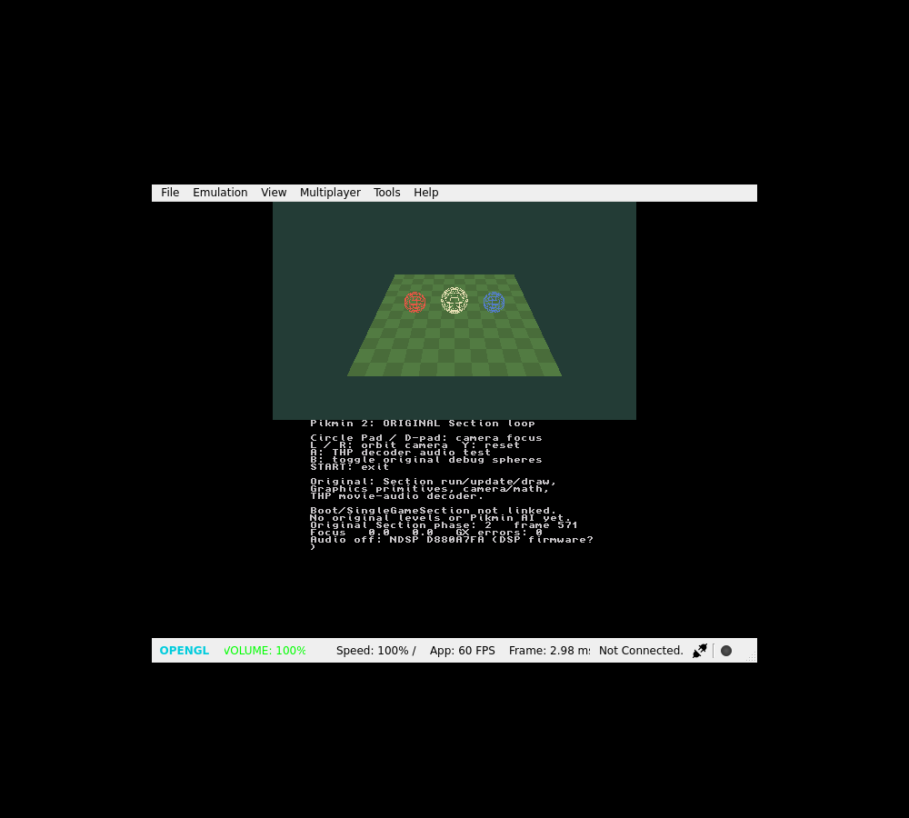

# Pikmin 2 native New 3DS port — prototype builder

**The previous viewer fails to render on the user's New 3DS XL and may freeze. This is NOT fixed or hardware-verified yet.** Major engine integration is paused at the hardware gate. This project aims to run original Pikmin 2 engine/gameplay code, not recreate the game.

## New: limited ISO-to-CIA resource prototype

```sh
python tools/build.py --iso "/path/to/Pikmin2.iso" --target cia
```

With an installed devkitPro SDK and `makerom`, this builds a native app that reads
the disc's **actual `opening.bnr`**, converts its 96×32 RGB5A3 image, embeds it in
RomFS and displays it beside the diagnostic spheres. It reuses the original
Section lifecycle, camera math and debug graphics extracts. It is **not a game
compiler, original model loader or playable Pikmin 2**.

Initially the validator permits only GPVE01 disc 0/revision 0 with the known
projectPiki executable checksum. **No real game dump has been tested here.**
Two synthetic-fixture builds passed real ARM compilation/CIA packaging, and the
installed CIA renders in Azahar. The production command rejects those fixtures;
there is no checksum bypass. **RVZ input now uses an installed DolphinTool**;
pass `--dolphin-tool "/path/to/DolphinTool"` if it is not on PATH. CISO remains
unsupported. RVZ conversion has been checked with synthetic data only.

**[Build tutorial and output locations](docs/BUILDING.md)** ·
**[Runtime details](port3ds/iso_prototype/README.md)** ·
**[Synthetic smoke-test CIA](https://github.com/andersoncallesj2-cloud/Pikmin2-3ds/raw/refs/heads/main/downloads/pikmin2-iso-fixture.cia)** ·
**[Synthetic smoke-test 3DSX](https://github.com/andersoncallesj2-cloud/Pikmin2-3ds/raw/refs/heads/main/downloads/pikmin2-iso-fixture.3dsx)**

The public smoke build contains a generated colour pattern, **no Nintendo asset**.
It starts in clear-colour mode: press **A** to show the card/spheres, **L/R** to
orbit and **START** to exit. A CIA built from a real ISO contains private game
data and must stay out of public downloads and Git history. The old Windows EXE
does not include this new Python pipeline; the native SDK tutorial requires no
Docker. Hardware testing remains pending for every new target.

## Optional Olimar model test (HW02)

**[Windows preparation kit](https://github.com/andersoncallesj2-cloud/Pikmin2-3ds/raw/refs/heads/main/downloads/pikmin2-model-test-windows.zip)** · **[CIA](https://github.com/andersoncallesj2-cloud/Pikmin2-3ds/raw/refs/heads/main/downloads/pikmin2-modeldiag.cia)** · **[Instructions](port3ds/modeldiag/README.md)**

The supplied Olimar OBJ/MTL (2,210 triangles) renders privately beside the three spheres in Azahar. It is currently untextured: original texture PNG files are not available to the converter, and helmet transparency/animation are not implemented. Real hardware remains unverified.

The public kit contains **no model data**. Extract it, drag your OBJ onto `Prepare Olimar.cmd`, copy the contents of `sd-card` onto your SD card, and select test 7 with R. B turns the model; Y reloads; START exits. Both CIA and 3DSX need the converted SD file. No Docker or separate Python installation is required.

This is an additional static-model test, not original J3D/character gameplay integration. HW01 and the hardware gate remain unchanged.

## Download the new HW01 diagnostic

**[CIA](https://github.com/andersoncallesj2-cloud/Pikmin2-3ds/raw/refs/heads/main/downloads/pikmin2-hwdiag.cia)** · **[3DSX](https://github.com/andersoncallesj2-cloud/Pikmin2-3ds/raw/refs/heads/main/downloads/pikmin2-hwdiag.3dsx)** · **[Exact test instructions](docs/TESTING.md)**

1. Copy the 3DSX to `/3ds/pikmin2-hwdiag/` and open it in Homebrew Launcher, or install the separate diagnostic CIA.
2. It starts with magenta clear colour. Check that the bottom heartbeat advances.
3. Use **R/Right** to test triangle, cube, checkerboard, spheres, then full scene; wait five seconds per stage. **L/Left** goes back.
4. **X** switches colour paths; **A** toggles depth. **START** exits. If a stage freezes, stop rather than repeating it.
5. Send the first failing test, launch format, a photo of both screens and `/3ds/pikmin2-hwdiag/hardware.log` if available. Do not send game data for this test.

HW01 adds real API checks, measured queue-busy time, a nonblocking queue polling path and independently flushed bottom text. A CPU-side PASS is not proof of visible rendering. Recovery from a genuinely wedged GPU/driver is not guaranteed. No ISO or firmware is required by this diagnostic.

The final CIA installs and runs all six stages in Azahar; colour/depth switches and clean START exit work. Physical New 3DS testing is **pending**. The original viewer/source/binaries remain below as an unchanged baseline.

[Port status](PORT_STATUS.md) · [Open Nectar/original-engine audit](docs/ENGINE_INTEGRATION.md) · [Build and private ISO/RVZ/CISO workflow](docs/BUILDING.md)

---

# Pikmin 2 original-engine port: first boot milestone

**[Archived viewer CIA — hardware issue](https://github.com/andersoncallesj2-cloud/Pikmin2-3ds/raw/refs/heads/main/downloads/pikmin2-port.cia)** · **[Download the Homebrew Launcher 3DSX](https://github.com/andersoncallesj2-cloud/Pikmin2-3ds/raw/refs/heads/main/downloads/pikmin2-port.3dsx)**

This first milestone boots the original Section lifecycle, original debug graphics and camera/game math on 3DS, with a ported THP movie-audio decoder. **It is not playable Pikmin 2 yet.** Original BootSection, title, levels, Pikmin AI and JAudio are not linked. No replacement gameplay/AI engine is used by this build.

## Tutorial: launch the tested build

1. Download `pikmin2-port.3dsx` above.
2. On your homebrew-capable 3DS SD card, create `/3ds/pikmin2-port/`.
3. Copy the 3DSX into that folder, reinsert the card, and open Homebrew Launcher.
4. Launch **Pikmin 2 Port Lab**. Alternatively, download/install the CIA using your existing homebrew CIA installer.
5. Use Circle Pad/D-pad to move the test camera, L/R to orbit, Y to reset, B to toggle the outer debug spheres, A to request the audio-decoder test, and START to exit.

No ROM, Docker, Windows compiler or original game assets are needed for this diagnostic. The checkerboard is generated; spheres execute the original graphics methods. Missing DSP firmware disables sound without preventing launch. Physical 3DS behavior and audible playback remain unverified.

## What works and what is next

Azahar 2126.2 tests pass: 3DSX boot, CIA install/launch, original main loop, camera/toggle/reset, zero GX adapter errors and clean exit. Original-source checks, math/graphics/decoder tests and six lifecycle scenarios pass, including address/undefined-behavior sanitizers. See [the source and detailed status](port3ds/README.md).

Five complete original engine bootstrap translation units also compile to ARM objects, but the full engine does not link yet. Endian/ABI bridging, real JKR/DVD/ARAM services, J3D resources and original gameplay sections are the next gates.



## Windows tools

[Native Windows bundle](https://github.com/andersoncallesj2-cloud/Pikmin2-3ds/raw/refs/heads/main/downloads/pikmin2-builder-windows-native.zip). No Docker required. The older Windows bundle is preserved; it does not package the new HW01 diagnostic. Use the direct HW01 downloads above for this test.

The bundle preserves all 2,151 uploaded original source files. [Original source license](port3ds/LICENSE.source.md). No game ROM or Nintendo assets are included in the diagnostic.
