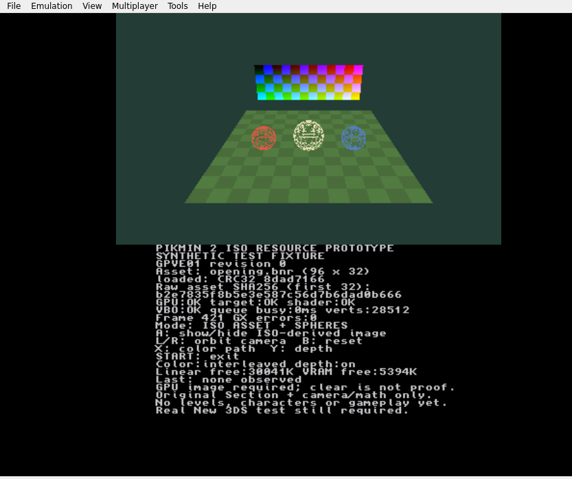

# ISO resource pipeline evidence — 2026-10-30

**All input data in these tests is generated synthetic data. No actual Pikmin 2
disc, original banner/model, or physical New 3DS was tested.** The public fixture
binaries contain this pattern and label themselves `SYNTHETIC TEST FIXTURE`.

## Build and parser checks

`PYTHONPATH=tools:tests python3 -m unittest discover -s tests -v`: **13 tests pass**.
This covers bounded disc parsing/decoding and failure reporting/input preservation,
plus the existing five model-converter tests. Compiler/package integration uses
`tests/run_iso_fixture.py` separately, without mocking either tool.

Two real devkitARM GCC 16.1.0 compilations and makerom packages passed; see
[run 0](fixture-build-0.json), [run 1](fixture-build-1.json),
[integration result](integration-result.json) and [compiler log](fixture-compile.log).
The installed SDK came from devkitPro image
`devkitpro/devkitarm@sha256:116afba8df8453961de2936ffab20dd441edf4d682856c1ec8b0e53d7ed0bbf5`.
Packager/source/output hashes are in each report. Internal workspace paths in
reports identify those historical runs; they are not required local paths.

Changing only the fixture banner, with the same synthetic executable, changes
both NCCH content and 3DSX. The entire converted resource is present in each
output. NCCH ExeFS/RomFS header-region hashes match. The inputs stay byte-identical.
The [production CLI rejects the synthetic executable](production-reject.json)
with checksum failure and produces no CIA. The test-only revision-table API does
not expose a skip flag in the production command.

The selected public run-0 downloads have these SHA-256 hashes:

```text
6c0794ab31da95f7ceb32dc27a8cd653ec3f6565a0ec6d5323c4869cea558a10  pikmin2-iso-fixture.cia
4aa771eff8a71fe713f242ceb5e9015fe72b41b041794567665b55b9a56ce26f  pikmin2-iso-fixture.3dsx
```

## Emulator observations

Tested the exact run-0 binaries above in Azahar 2126.2 on Linux/Xvfb with Mesa
software rendering. This is independent of real PICA200 behavior.

| Check | Evidence/result |
| --- | --- |
| CIA install | [Installer log](cia-install.log): `Installed CIA successfully` |
| CIA safe start | [Clear colour and live resource overlay](cia-clear.png) |
| CIA resource draw | [Synthetic card, spheres and floor](cia-asset.png); CRC `8dad7166`, source SHA prefix `b2e7835f8b5e3e587c56d7b6dad0b666`, 28,512 vertices, zero GX adapter errors |
| Camera input | [R orbit changes view](cia-orbit.png) |
| CIA START | [Returns to emulator title list](cia-exit.png) |
| 3DSX load/draw | [Same embedded resource renders](3dsx-asset.png) |
| 3DSX START | [Returns to emulator title list](3dsx-exit.png) |

The app [run log](cia-run.log) and [3DSX log](3dsx-run.log) contain host Qt locale,
PipeWire and `xdg-mime` availability messages. These are not fabricated GPU
success reports; the visible runtime checks/screenshots supply app observations.



## Not established

- No actual GPVE01 disc or genuine extracted image has been tested.
- No original JKR/J3D asset path, level, model, character logic or gameplay added.
- These original package tests used raw ISO fixtures. A later
  [RVZ preparation check](rvz/README.md) uses real Dolphin conversion of synthetic
  data. CISO and the full Windows builder workflow remain untested/unimplemented
  as described in the build tutorial.
- Physical New 3DS rendering, clean exit, stability, memory budget and performance
  are **unverified**. The user's earlier no-scene/freeze report remains open.

The next hardware action remains [HW01's six stages](../../../docs/TESTING.md),
then this probe's A/image and START/exit checks if HW01 is stable. A private
matching game dump is also needed to validate the production asset path.
